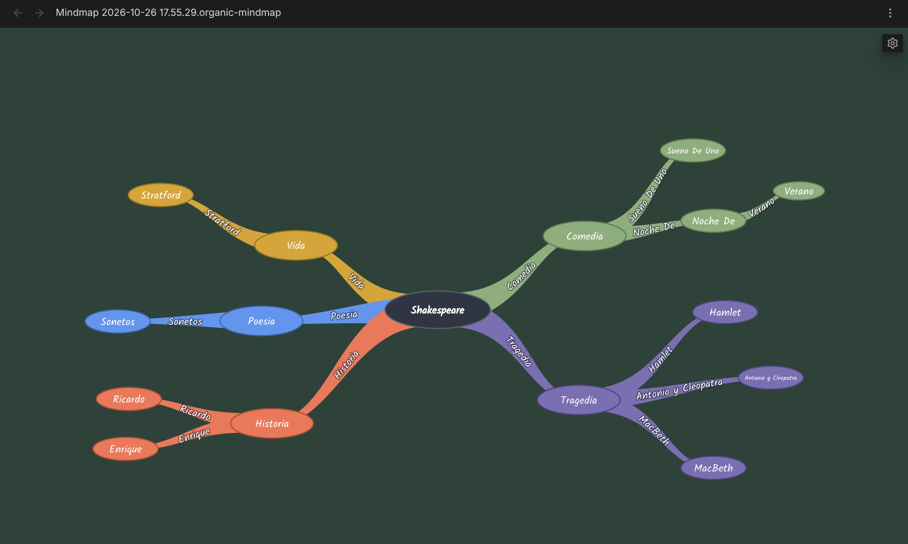

# Organic Mindmap

Mindmaps for [Obsidian](https://obsidian.md) that feel hand-drawn: organic, tapering branches with their labels
written along them, and a tidy two-sided layout that does not look machine-made. Each mindmap is a plain Markdown
note, so it stays readable, linkable and searchable like any other note.



**Status: in development, not yet in the Community plugins list.** Desktop only, Obsidian 1.12.7 or newer.

## Features

- **A map is a note.** The note's nested list is the tree. Edit it as a map or as Markdown; both stay in sync.
- **Edit on the map.** Add, rename, move and delete nodes with the mouse; undo and redo with the usual keys.
- **Your layout sticks.** Drag a node where you want it and it stays there after you reopen the note.
- **Links work.** `[[Links]]` in a node open the linked note, and Obsidian keeps them updated when notes are renamed.
- **Make it yours.** Branch colors, fonts and background color, changed live over the map.
- **Offline.** No network access; every font is bundled.

## Install

Until the plugin is in Community plugins, build it from source (needs [Node.js](https://nodejs.org) and `git`):

```bash
git clone https://github.com/nickolay-kondratyev/organic-mindmap.git
cd organic-mindmap
npm install
npm run build                 # builds main.js and styles.css at the repo root
```

The repo root is the plugin folder (`main.js`, `manifest.json`, `styles.css`). Link it into your vault:

```bash
ln -s "$PWD" "<your vault>/.obsidian/plugins/organic-mindmap"
```

Then in Obsidian: Settings > Community plugins > enable "Organic Mindmap".

## Use

### Create a mindmap

- Command palette: **Create new mindmap**. It makes `Mindmap <timestamp>.organic-mindmap.md` in your default
  new-note folder and opens it as a map.
- File explorer: right-click a folder > **New organic mindmap** makes one in that folder.
- Or turn an existing note into a map: add `organic-mindmap: 1` to its frontmatter. The note needs exactly one
  top-level list item (the root).

### What the note looks like

```markdown
---
organic-mindmap: 1
---
- Project Phoenix ^root
	- [[Some note]] ^n7f3k
		- plain idea ^n9a2b
```

The nested list is the tree. The `^n7f3k` block ids are added for you and keep each node's identity. Dragged node
positions are saved in a hidden `%%` comment block after the list.

### Open

A mindmap note opens as a map wherever you open it (file explorer, links, quick switcher). To see the Markdown, use
"Open as Markdown" in the map's "..." menu, or the command **Toggle mindmap / Markdown view** (works both ways).

### Edit on the map

| To | Do |
|---|---|
| Add a child | Hover a node, click **+** |
| Rename | Double-click the node |
| Move under another node | Drag it onto that node |
| Place it somewhere else | Drag it to empty space; the spot is saved |
| Delete | Right-click > **Delete** (the notice that follows has **Undo**; the root cannot be deleted) |
| Undo / redo | Ctrl+Z / Ctrl+Shift+Z (Cmd on macOS) |
| Open a link | Click a node with a `[[link]]` (Ctrl/Cmd-click: new tab) |

Every change is written to the note right away. Edits made in a Markdown tab, or synced in from another device, show
up on the open map.

Undo/redo covers changes made on the map, one step per action. If the note changes outside the map (typing in a
Markdown tab, sync), the map's history is cleared and a notice tells you. Switching the view to another note or
closing it also clears the history.

Nodes you never dragged follow the automatic layout. A dragged node's position is kept relative to its parent, so it
moves along when the parent moves.

If a note cannot be shown as a map, the view says why and offers "Open as Markdown".

### Settings

Settings > Organic Mindmap, or the gear in a map's top-right corner (opens the settings over the map, so you see each
change as you make it):

- **Branch colors:** Warm, Vivid, Muted, Monochrome
- **Node font** and **branch font:** Kalam, Caveat, Patrick Hand, Nunito
- **Background color**
- **Restore look defaults**

Changes apply to every open map at once and are kept across restarts.

## Privacy

The plugin makes no network requests. All fonts are bundled (SIL Open Font License; license files sit next to the
fonts in `core/assets/fonts/` and `obsidian-plugin/assets/fonts/`).

## For developers

- Build, test and repo layout: [docs/development.md](docs/development.md)
- The plugin is built on the standalone mindmap library in [`core/`](core/README.md), which also runs outside Obsidian.

## License

[Kondratyev Source Available License 3.0](LICENSE.md).
